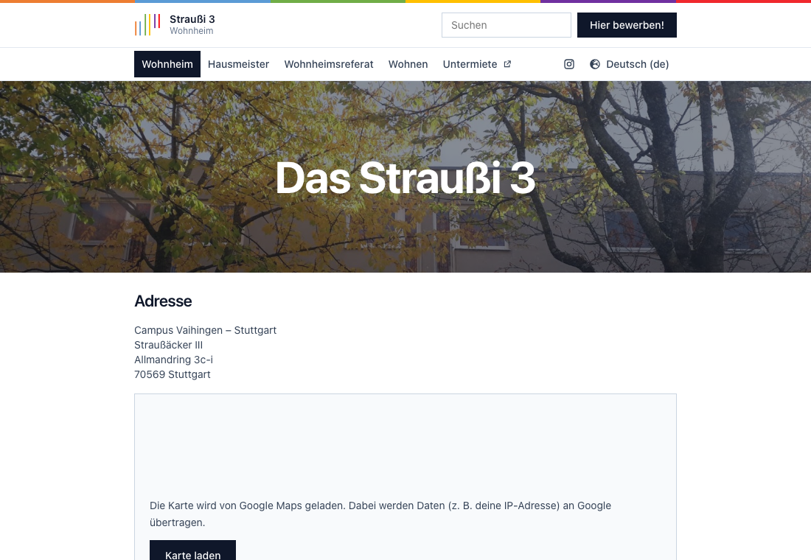
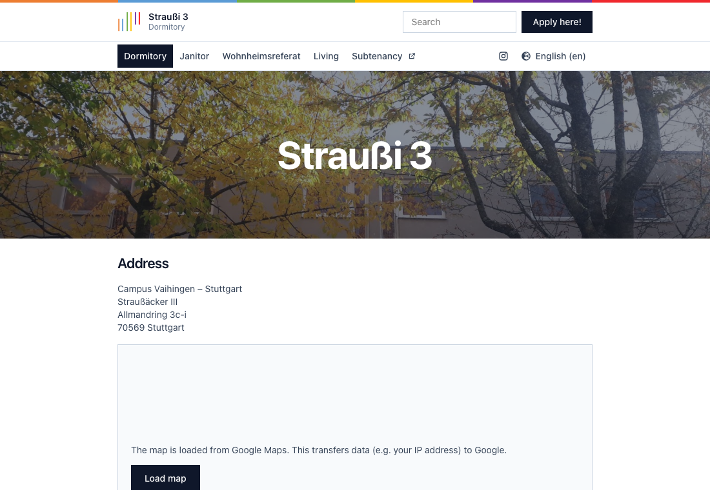
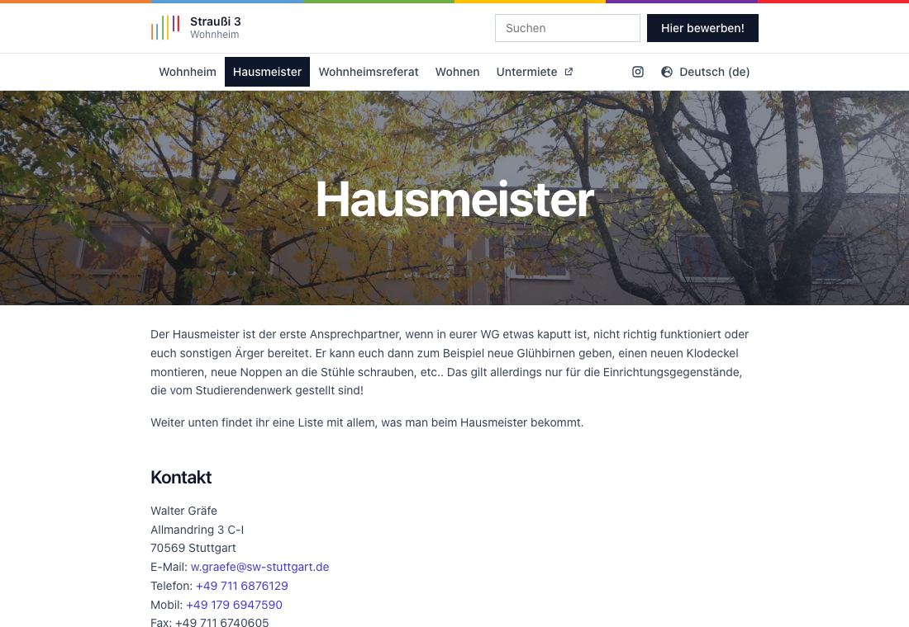
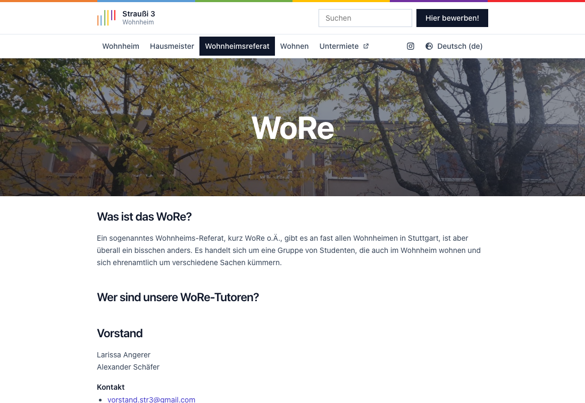
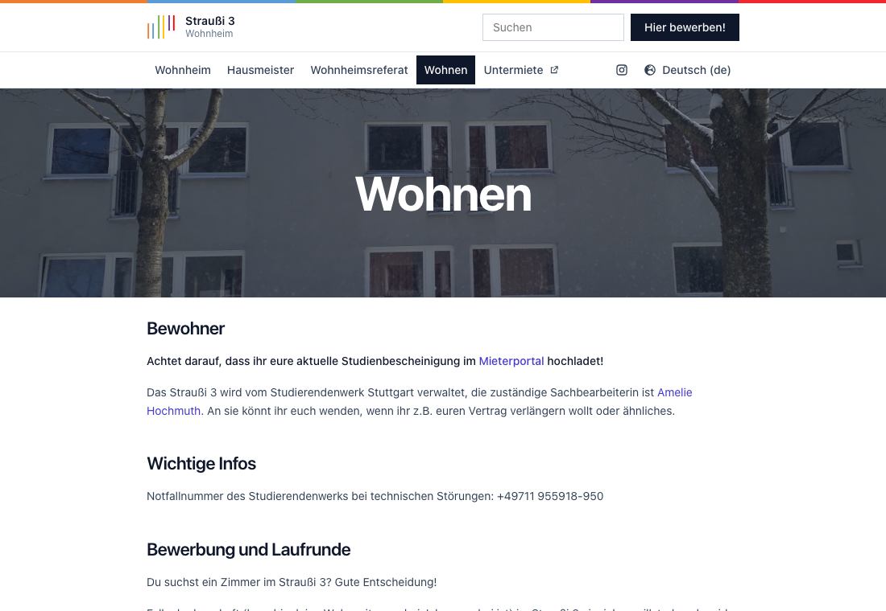

# Straussi3 Website

Website of the Straussi3, the student dormitory Straußäcker III in Stuttgart, in German and English.

- Link: https://straussi3.de
- Repo: https://github.com/milesstoetzner/straussi3-website
- Subtenancy: https://untermiete.straussi3.de

## Screenshots

| | |
|---|---|
|  |  |
|  |  |
|  | |

## Development

```sh
npm install
npm run dev      # http://localhost:5173
npm run build    # production build in dist/
npm run preview  # serve the production build
npm run lint
```

## Structure

- `src/content/de.tsx`, `src/content/en.tsx` – all page texts per language (same shape, typed in `src/i18n/types.ts`)
- `src/content/impressum.md`, `src/content/datenschutz.md` – legal pages (German only, as on the original site)
- `src/i18n/LanguageContext.tsx` – language state, persisted in `localStorage`, defaults to the browser language
- `src/pages/` – one component per page, `src/components/` – header, footer, hero, embeds
- `src/assets/` – photos from the original site and the logo, redrawn as SVG (`logo.svg`, also used as favicon)
- `src/search/` – client-side search over all page texts; results jump to the section's heading
- `src/components/ConsentEmbed.tsx` – consent gate for third-party embeds (Google Maps, Google Sheets)

## Routes

`/`, `/hausmeister`, `/wore`, `/wohnen`, `/impressum`, `/datenschutz`. The old `/english-version/*` URLs
redirect to the matching page and switch the language to English.

The app is a single-page app, so the web server must serve `index.html` for all of these paths.

## Deployment

`npm run build` writes a static site to `dist/`. Serve that directory with any web server that returns
`index.html` for unknown paths (SPA fallback). The site is built for `/` by default; set `BASE_PATH`
(e.g. `BASE_PATH=/straussi3-website/`) when it is served from a sub-path.
